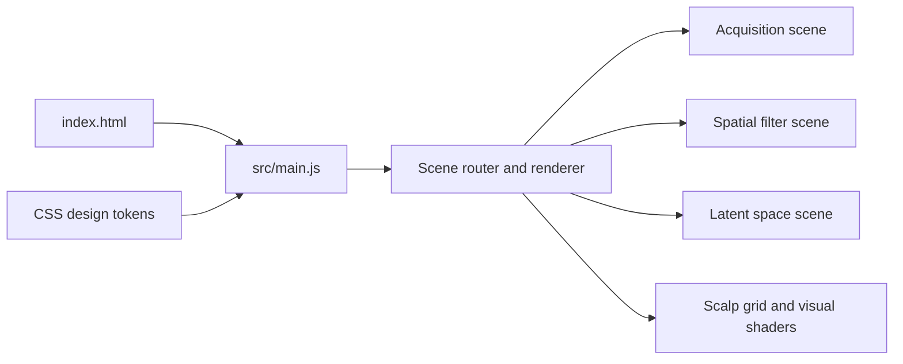

# Neuro Decode

An interactive browser-based explainer of EEG decoding concepts, using animated scalp, acquisition, spatial-filter, and latent-space scenes rather than a trained BCI model.

## Results

- `npm ci` completed successfully.
- `npm run build` completed successfully.
- The local Vite development server responded.
- No signal-classification accuracy or inference latency is claimed: the checked-in project is a visual explainer, not an EEG decoder.
- The production build warns that its JavaScript chunk is about 550 KB.

## Architecture



## Quickstart

Verified on the local checkout:

```bash
cd neuro-decode
npm ci
npm run build
npm run dev -- --host 127.0.0.1
```

## Limitations

- The interface does not ingest EEG or run trained inference.
- The build emits a large-chunk warning; performance on mobile/low-power devices is unknown.
- No automated visual or interaction tests were found in the reviewed checkout.

## Next steps

1. Split vendor and scene code to reduce the initial bundle.
2. Add smoke tests for route transitions and reduced-motion behavior.
3. Add an explicit “conceptual visualization” label wherever diagrams could be mistaken for measured output.
4. If adding signal playback, keep synthetic/demo data visibly distinct from real acquisition.
